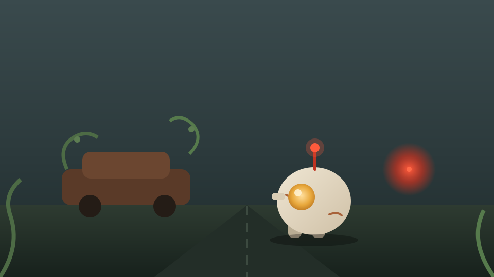
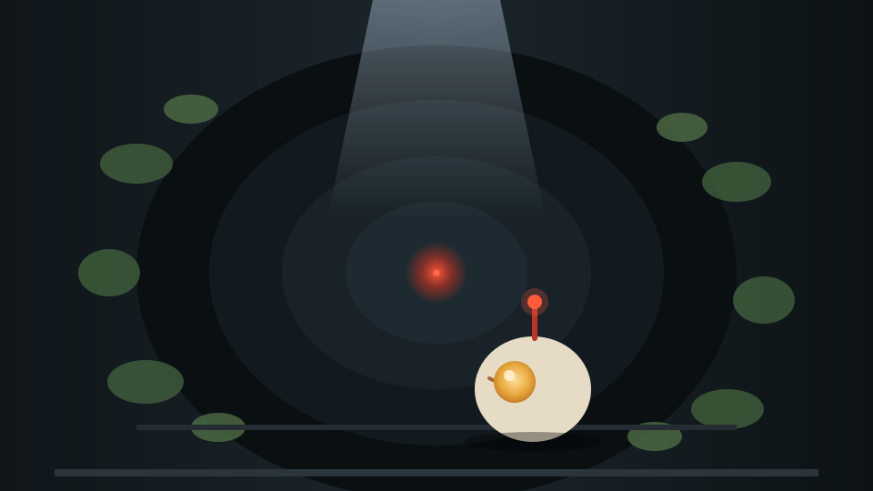
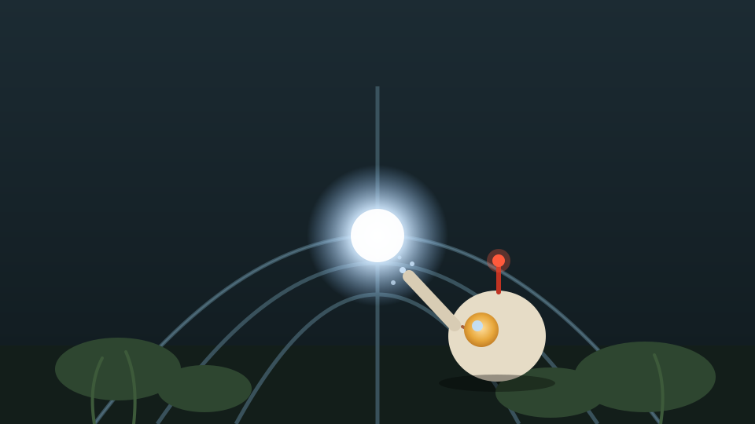
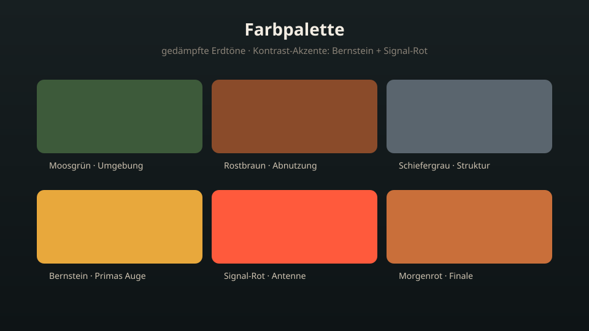
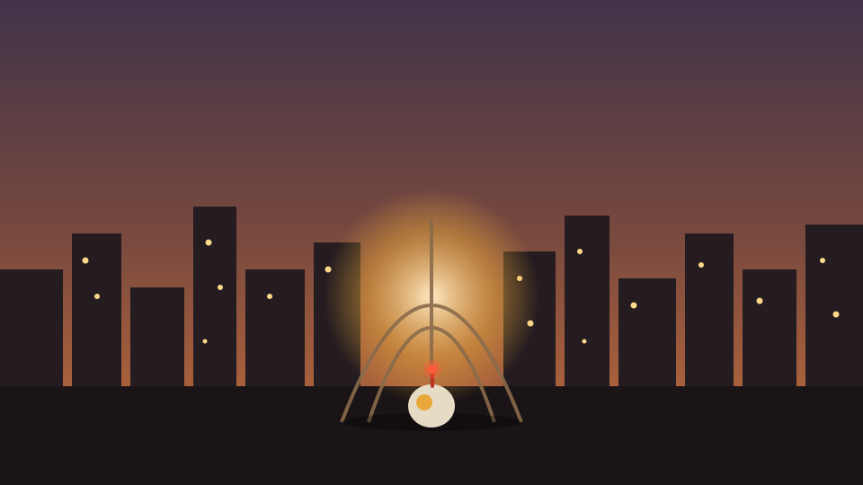
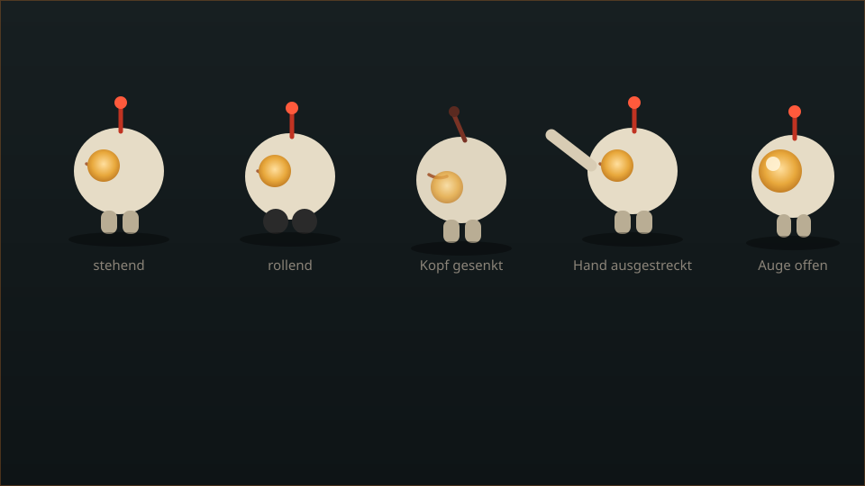
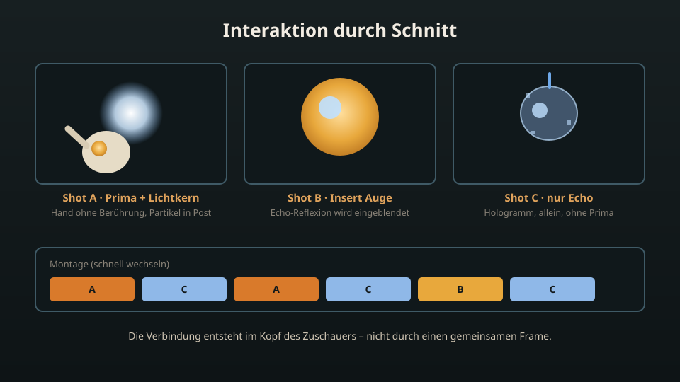

<!-- _class: lead -->
# „Echo im Rost"

## Aktuellder Stand der Roboter-Idee

**Gruppe 17 · KI in der Medienproduktion · 02.11.2026**

<div class="badge">Exposé-Kandidat · Abgabe 08.11. · Gruppenentscheidung offen</div>

---

# Auf einen Blick

::: two
::: figure

:::
::: figure
**Logline:** Ein einsamer Roboter entdeckt in einer von der Natur zurückeroberten Stadt, dass seine verlorene Partnerin nie weg war, sondern in ihm lebt – und weckt mit seinem Signal die Lichter der toten Stadt wieder zum Leben.

- **Format:** Musikvideo, 3–5 Min., vollständig KI-generiert (lokal)
- **Figuren:** 2 → Roboter „Prima" + Echo als Hologramm
- **Orte:** 4 → Straße, U-Bahn-Tunnel, Parklichtung, Glas-Kuppel
- **Leitmotiv:** das rote Signal
:::
:::

---

# Die Figuren

::: two
::: figure
### Prima (Protagonist)

- Kleiner, runder Roboter, ~30 cm, cremefarbene Schale mit rostfarbenen Kratzern
- Ein großes, rundes **Bernstein-Auge** (Emotionen via Helligkeit/Fokus)
- Dünne, **leuchtend rote Antenne** als Signalgeber
- Kleiner, abgenutzter **grauer Rucksack**
- Kompakt und stämmig, kurze dicke Beine
:::
::: figure
### Echo (nur als Hologramm)

- Identische runde Schale, aber **ohne Rost**, mit innerem Glimmen
- Stärker strahlendes Auge, Antenne schimmert **blau**
- Halbtransparent, Pixel-Artefakte an den Rändern, schwebend

> Visuell bewusst von Prima abgesetzt → kein physischer Konsistenz-Druck
:::
:::

---

# Handlung in drei Akten

::: figures3
::: figure

**Akt 1 · Das Signal**
:::
::: figure

**Akt 2 · Die Suche**
:::
::: figure

**Akt 3 · Die Erkenntnis**
:::
:::

- **Akt 1:** Primas Auge öffnet sich in einer überwucherten Straße, rote Antenne pulsiert schwach.
- **Akt 2:** U-Bahn-Tunnel, Moos, Signal wird schwächer. *Bridge:* Parklichtung, Regen, Antenne erlischt.
- **Akt 3:** Signal wird klar → Glas-Kuppel. **Twist:** Echo ist eine in Prima gespeicherte Erinnerung. Finale: Stadt erwacht.

---

# Bildstil

::: two
::: figure
**Farbpalette**
- Gedämpfte Erdtöne: Moosgrün, Rostbraun, Schiefergrau
- Kontrast-Akzente: Bernstein-Gelb (Auge), intensives Signal-Rot
- Finale: warmes Morgenrot + kühles Blau im Schatten

**Licht**
- Akt 1: diffuses Morgengrau
- Tunnel: hartes, kaltes Licht von oben
- Kuppel: weiches, inneres Leuchten

**Kamera**
- Cinematisch, leicht anamorpher Look
- **Nur statische oder lineare Bewegungen** (Dolly/Truck)
- Keine Follow-Shots → Dynamik ausschließlich im Schnitt
:::
::: figure

:::
:::

---

# Musikstil (ACE-Step 1.5)

**Stil:** Cinematic Post-Rock mit orchestralen Elementen

| Abschnitt | Klang |
| --- | --- |
| **Intro/Strophe** | Tiefe Drums, Synth-Pads, Gitarren-Klirrer, ~70 BPM, melancholisch |
| **Refrain** | Percussion, epische Streicher, hallende Synths, **weibliche ethereale Vocals** |
| **Bridge** | Minimalistisch: pulsierender Bass + Antennen-Sounddesign |
| **Finale Refrain** | Volles Orchester, triumphale Melodie, Vocals klarer; Ende = hallender Akkord + „Einschalten" der Stadt |

> ⚠️ Weibliche ethereale Vocals im Refrain – **noch von der Gruppe zu bestätigen**

---

# Produktions-Pipeline

::: two
::: figure
```
Exposé → Drehbuch → Storyboard
       → Shotlist (JSON)
       → Song (ACE-Step)
       → Master-Posen (FLUX.1 dev)
       → I2V-Clips (Wan 2.2)
       → Schnitt & Mix → Film + Poster
```

- **Bild:** FLUX.1 dev · **Video:** Wan 2.2 (I2V)
- **Musik:** ACE-Step 1.5 · **Post:** ComfyUI / DaVinci Resolve
:::
::: figure

:::
:::

---

# Technik: Konsistenz & I2V

::: two
::: figure
**Kern-Problem:** Wan 2.2 hat **keinen Gedächtnis-Kontext** über Clips hinweg.

**Lösung: I2V für jeden Clip**
1. FLUX.1 dev: **ein** perfektes Master-Bild in der Ziel-Pose
2. Als **Startframe** für Wan 2.2 nutzen
3. Im Wan-Prompt **nur die Bewegung**, keine Figur
4. Identität via **IP-Adapter / LoRA** erzwingen

**5 Master-Posen:** stehend · rollend · Kopf gesenkt · Hand ausgestreckt · Auge offen
:::
::: figure

:::
:::

---

# Risiken & Lösungen (Kritik-Runde)

::: cards3
::: card
### 1 · Hologramm-Interaktion
**Risiko:** Prima + Echo im selben Frame → Licht/Schatten-Physik bricht zusammen.

**Lösung:** *Interaktion durch Schnitt* – Shot A (Prima + Lichtkern), Shot B (Auge, Reflexion in Post), Shot C (nur Echo). A+C wechseln.
:::
::: card
### 2 · „Wackelkamera"
**Risiko:** Handheld + schnelle Schnitte = Morphing, frisst Clip-Budget.

**Lösung:** 3–4 *statische/lineare Shots* (frontal, seitlich, Rückansicht). Dynamik durch Schnitttempo.
:::
::: card
### 3 · Figurenkonsistenz
**Risiko:** Modell interpretiert Figur neu (Antenne rot/orange, Auge groß/klein).

**Lösung:** Strenge *I2V-Pipeline* mit 5 Master-Images, Identität via IP-Adapter/LoRA.
:::
:::

---

# Finale: Interaktion durch Schnitt

::: two
::: figure
**Kein gemeinsamer Frame.** Die emotionale „Berührung" entsteht im Rhythmus des Schnitts:

- **Shot A:** Prima + Lichtkern, Hand ohne Berührung (Partikel in Post)
- **Shot B:** Großaufnahme Auge mit Echo-Reflexion (Post)
- **Shot C:** nur Echo-Hologramm, allein, pulsierend
- **Montage:** A + C schnell wechseln → Verbindung im Kopf des Zuschauers
:::
::: figure

:::
:::

---

# Was wurde verworfen (und warum)

| Verworfen | Grund |
| --- | --- |
| Wackelkamera / Follow-Shots | technisch nicht zuverlässig mit Wan 2.2 |
| Gemeinsamer Frame Prima + Echo | nicht renderbar, physikalisch unsinnig |
| „Refrain = schnelle Schnitte im Modell" | Clip-Budget + Artefakt-Risiko |

> **Prinzip: Dynamik entsteht im Schnitt, nicht im Modell.**

---

# Entscheidungen (diese Sitzung, 02.11.)

- **Roboter-Name:** Prima
- **Echo:** ausschließlich als Hologramm (zählt zur 2-Figuren-Grenze)
- **Prima:** 5 feste Merkmale, in jedem Prompt identisch
- **4 Orte:** Straße, U-Bahn-Tunnel, Parklichtung, Glas-Kuppel
- **Twist** (Erinnerung) in Szene 7, direkt nach der leisen Bridge
- **Finale:** Signal + Stadt erwacht
- **Musik:** Cinematic Post-Rock, ~70 BPM, weibliche ethereale Vocals

---

# Offene Punkte & Nächste Schritte

- [ ] **Gruppenentscheidung:** „Echo im Rost" vs. „Gravity of Wild" (Fabian) → Abgabe 08.11.
- [ ] **Musik:** weibliche ethereale Vocals bestätigen (ACE-Step 1.5)
- [ ] **Drehbuch + Storyboard** aus dem Exposé ableiten
- [ ] **Shotlist** als JSON (gemeinsames Schema)
- [ ] **Master-Posen** generieren (FLUX.1 dev, 5 Poses, IP-Adapter/LoRA)
- [ ] **Pilot-Clips** mit Wan 2.2 (I2V) – Konsistenz testen

**Rechte-Status:** Originalfiktion der Gruppe, frei für das Kursprojekt verwendbar.

---

# Quellen & Dateien im Repo

| Datei | Inhalt |
| --- | --- |
| `expose/echo-im-rost.md` | Endgültiges Exposé (inkl. manueller Korrektur) |
| `prompts/expose_robostadt.txt` | Prompt-Vorlage (Rolle, Kontext, Aufgabe, Format, Einschränkungen) |
| `prompts/expose_kritik.txt` | Kritiker-Prompt |
| `prompts/expose_ueberarbeitung.txt` | Überarbeitungs-Prompt |
| `prompts/kritik_ergebnis.md` | Kritiker-Output (3 Schwächen) |
| `log.md` | Alle Generierungen: Modell, Parameter, Laufzeit, Entscheidungen |

**Modell:** Qwen3.8-27B (Ollama, Q4_K_M), `think=false`, Kontext 262k
**Laufzeiten:** Entwurf T=0,8 · ~93 s · Kritik T=0,7 · ~66 s · Überarbeitung T=0,7 · ~58 s
